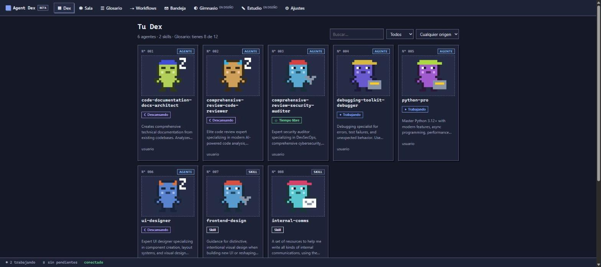
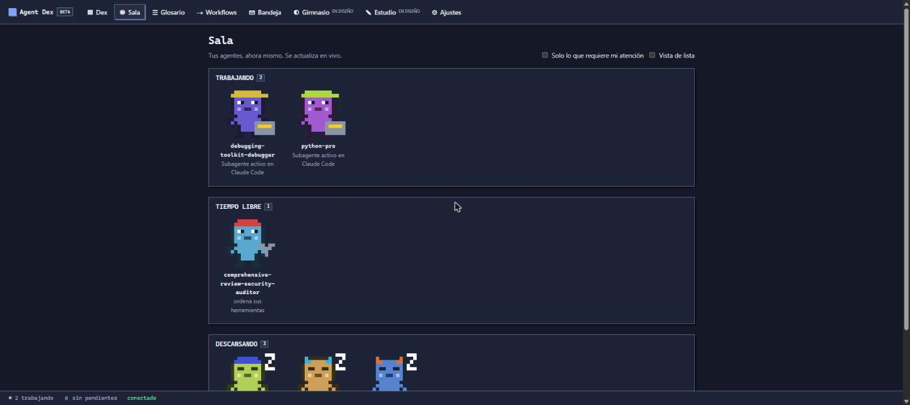
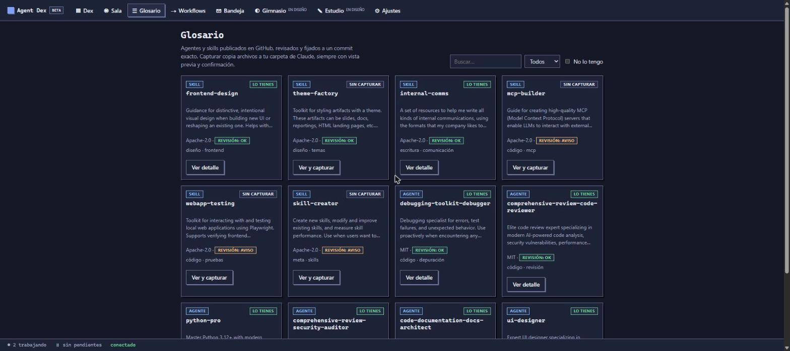

# Agent Dex

**Coleccionador, entrenador y orquestador de agentes de IA para Claude Code.**
Una interfaz web local donde ves a tus agentes y skills como una colección viva, hablas con ellos, los pones a trabajar solos o encadenados con pausas para que decidas tú, y capturas otros nuevos desde un glosario revisado de GitHub.




> **Beta `0.1.0-beta.1`.** Lo que aparece en la tabla «Disponible» funciona y está probado. El resto está en diseño y la propia aplicación lo marca así. Lee las [limitaciones](#limitaciones-de-la-beta) antes de instalar.

## Qué puedes hacer hoy

| Función | Estado | Qué hace |
|---|---|---|
| **Dex** | Disponible | Colección numerada de tus agentes y skills (usuario, proyecto y plugins), con filtros y siluetas de lo que aún no tienes |
| **Sala en vivo** | Disponible | Personajes animados según lo que hacen: trabajando, entrenando, descansando, tiempo libre, esperando, error |
| **Chat** | Disponible | Habla con cualquier agente; verás su respuesta en vivo y aprobarás sus permisos en la propia conversación |
| **Tareas sin supervisión** | Disponible | Describe una tarea y el agente trabaja solo, con límites obligatorios de turnos y presupuesto |
| **Bandeja** | Disponible | Todo lo que espera una decisión tuya. Nada vence ni se aprueba solo |
| **Workflows** | Beta | Agentes que se pasan el trabajo uno a otro, con decisiones humanas (aprobar, editar, rechazar). Solo lineales |
| **Glosario** | Beta | 12 agentes y skills públicos, fijados a un commit y verificados por hash. Capturar y liberar con vista previa |
| Gimnasio, Estudio de imagen, Creador guiado, exportar a Codex y Copilot | En diseño | Ver [`docs/proyecto.md`](docs/proyecto.md) |

<table>
<tr>
<td width="50%"></td>
<td width="50%"></td>
</tr>
</table>

## Instalación

### Requisitos

- [Claude Code](https://docs.claude.com/en/docs/claude-code) con sesión iniciada.
- [`uv`](https://docs.astral.sh/uv/getting-started/installation/) (Windows, macOS o Linux).
- Un navegador moderno. Unos 300 MB de descarga la primera vez (incluye el SDK de Claude Code).

### Como plugin de Claude Code (recomendado)

Dentro de Claude Code:

```text
/plugin marketplace add f3r4lonso/claude-plugin-agent-dex
/plugin install agent-dex@agent-dex
/agent-dex:abrir
```

`/agent-dex:abrir` inicia el servicio local y abre la interfaz. Para que la **Sala** vea a tus subagentes de Claude Code en vivo, reinicia Claude Code tras instalar el plugin (activa sus hooks).

### Sin plugin

```text
uvx --from "git+https://github.com/f3r4lonso/claude-plugin-agent-dex@v0.1.0-beta#subdirectory=api" agent-dex serve --open
```

O con pip (Python 3.11+):

```text
pip install "git+https://github.com/f3r4lonso/claude-plugin-agent-dex@v0.1.0-beta#subdirectory=api"
agent-dex serve --open
```

El terminal muestra una dirección `http://127.0.0.1:8771/#t=…`. El código `#t=` es privado: es lo que protege tu ordenador de otras páginas web.

## Cómo funciona

```text
Claude Code ── plugin ──► /agent-dex:abrir ──► servicio local (Python, FastAPI, 127.0.0.1)
                │                                   │   ├─ lee ~/.claude (agentes, skills, plugins)
                └─ hooks de subagentes ─────────────┤   ├─ chats y tareas con el SDK de Claude Code
                                                    │   └─ glosario → GitHub (solo al capturar)
                                                    ▼
                                            Interfaz web (React) en tu navegador
```

- **Sin cuentas ni telemetría.** Todo corre en tu ordenador. Los chats usan tu propia sesión de Claude Code.
- **Tu carpeta `.claude` se lee siempre y se escribe solo al capturar o liberar**, con vista previa y confirmación.
- Los datos propios (historial, workflows) viven en `~/.agent-dex/`.

## Seguridad

Solo `127.0.0.1`, código de arranque aleatorio, validación de `Host` y `Origin`, CSP estricta y texto siempre escapado. Los agentes piden permiso antes de editar o ejecutar; las tareas en «solo lectura» deniegan lo demás. Las capturas se verifican por hash, nunca sobrescriben y nunca ejecutan lo descargado. Detalle y límites en [`SECURITY.md`](SECURITY.md).

## Limitaciones de la beta

- **Workflows solo lineales.** Si cierras la aplicación, lo que estaba en curso queda «interrumpido» (no se reanuda).
- **Primera instalación pesada** (≈ 300 MB) por el SDK de Claude Code.
- **Sala en vivo:** los hooks asumen el puerto `8771`. Si ese puerto está ocupado y el servicio usa otro, la Sala no recibirá eventos de subagentes.
- **Probado a mano en Windows;** macOS y Linux se prueban en integración continua, no a mano.
- Las estadísticas del agente salen solo de lo que ejecutas desde Agent Dex.
- Claude Code es el único cliente soportado; Codex y Copilot están en diseño.

## Desarrollo

```text
cd api && python -m venv .venv && .venv/bin/pip install -e ".[dev]" && .venv/bin/python -m pytest
cd web && npm ci --ignore-scripts && npm test && npm run build
```

Más en [`CONTRIBUTING.md`](CONTRIBUTING.md). Registro de cambios: [`CHANGELOG.md`](CHANGELOG.md).

## Documentación del proyecto

| Documento | Contenido |
|---|---|
| [`docs/proyecto.md`](docs/proyecto.md) | Descripción completa y las 16 funcionalidades planificadas |
| [`docs/stack-tecnico.md`](docs/stack-tecnico.md) | Stack, seguridad local y despliegue |
| [`docs/diseno-ui.md`](docs/diseno-ui.md) | Diseño UI/UX de todas las pantallas |
| [`docs/roadmap.md`](docs/roadmap.md) | Hoja de ruta |
| [`docs/adr/`](docs/adr) | Decisiones técnicas |
| [`docs/dependencias.md`](docs/dependencias.md) | Licencias y revisión de dependencias |
| [`docs/gym.md`](docs/gym.md), [`docs/prompts-imagen.md`](docs/prompts-imagen.md) | Diseño de funciones futuras |

## Licencia

[MIT](LICENSE). Los agentes y skills del Glosario mantienen la licencia de sus repositorios de origen.
